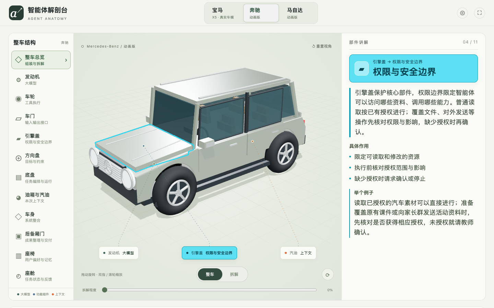

# 智能体解剖台

多品牌汽车 HTML/WebGL 教学演示，用汽车部件解释智能体的组成与任务流程。宝马 X5 使用真实 BMW G05 模型；奔驰、马自达为自绘简化三维动画版，并非精确复刻，页面按钮已注明。

## 在线体验与下载

- [**打开在线演示（无需登录）**](https://xman61.github.io/agent-car-anatomy/)
- [**下载完整 ZIP 包**](https://github.com/xman61/agent-car-anatomy/releases/latest)
- [源码仓库](https://github.com/xman61/agent-car-anatomy)

在发布页下载 `agent-car-anatomy-v1.0.0.zip`。需要直接讲解时，打开上方在线演示即可；下载到本机的运行方法见下文。



## 操作步骤

1. 顶部选择宝马、奔驰或马自达，切换约有 650ms 入场动画；系统开启“减少动态效果”时跳过。
2. 拖动旋转、滚轮或手势缩放；切换整车/爆炸拆解并调整拆解程度。
3. 点击部件单独放大，查看作用与例子；保留原材质，并用亮色轮廓突出选中部件，点击“返回整车”或按 `Esc` 退出。
4. 运行“设计一节 20 分钟认识汽车活动”演示，依次查看明确目标、模型规划、调用工具、读取反馈、整理结果，支持暂停/继续/下一步。
5. 发动机、车轮、汽油提供拆下/移除实验；其他部件仅支持单独放大。

切换品牌会保留拆解程度和装配状态，退出单件放大并暂停任务。资源均内置，不实时下载第三方车模。布局适配电脑、平板，手机采用纵向排布。

## 本地运行

准备：安装 Node.js，并使用支持 WebGL 的浏览器。所有三维依赖和车模已随包提供，无需 `npm install` 或 API Key。

**下载 ZIP：** 解压后，在含 `serve.cjs` 的 `agent-car-anatomy` 文件夹中打开终端，执行：

```bash
node serve.cjs
```

打开 [http://127.0.0.1:4173](http://127.0.0.1:4173)，按 `Ctrl+C` 停止服务。首次下载完成后，本地运行不需要联网。

**也可以克隆源码：**

```bash
git clone https://github.com/xman61/agent-car-anatomy.git
cd agent-car-anatomy
node serve.cjs
```

Node.js 仅用于 HTTP 预览。不要直接双击 `dist/index.html`，ES 模块和模型需要通过 HTTP 加载。

## 11 个部件对应表

| 汽车部件 | 智能体概念 |
|---|---|
| 发动机 | 大模型 |
| 车轮 | 工具执行 |
| 车门 | 输入输出接口 |
| 引擎盖 | 权限与安全边界 |
| 方向盘 | 目标与约束 |
| 底盘 | 任务编排与运行 |
| 油箱与汽油 | 本次上下文 |
| 车身 | 系统整合 |
| 后备厢门 | 成果整理与交付 |
| 座椅 | 用户偏好与记忆 |
| 座舱 | 任务状态与反馈 |

## 目录

```text
dist/
  index.html、style.css    页面
  app.js                   交互
  components.js            讲解映射
  car-scene.js             三维场景与品牌切换
  sedan-assembly.js        宝马组装
  brand-models.js          品牌配置与简化动画车模
  selection-outline.js     轮廓
  models/                  模型与授权
serve.cjs                  本地预览
docs/preview.png           演示截图
.github/workflows/pages.yml Pages 部署
```

## 部署与维护

纯静态 HTML/CSS/JavaScript，Three.js 0.169.0 已本地打包。`main` 分支修改 `dist` 会触发工作流并发布到 GitHub Pages。复用到自己的仓库时，需要先在仓库 Settings → Pages 中选择 GitHub Actions。新增真实车模不能只替换 GLB，还需适配部件名称、分组及拆解逻辑。

## 限制与素材署名

任务结果均为固定逻辑教学模拟，不调用真实大模型、搜索或文件生成服务。第三方模型和代码分别适用各自许可证，本仓库未声明覆盖全部文件的统一 MIT 许可。

- BMW X5 G05：BMW Car IT [digital-car-3d](https://github.com/bmwcarit/digital-car-3d)，CC BY 4.0。
- 发动机：Khronos [CarConcept](https://github.com/KhronosGroup/glTF-Sample-Assets/tree/main/Models/CarConcept)，Eric Chadwick / Darmstadt Graphics Group GmbH（2024），CC BY 4.0。
- 详见[完整素材归属](dist/models/ATTRIBUTION.txt)、[BMW 许可](dist/models/BMW-LICENSE.txt)和 [Three.js 许可](dist/THREE-LICENSE.txt)。品牌商标归各自权利人所有。
